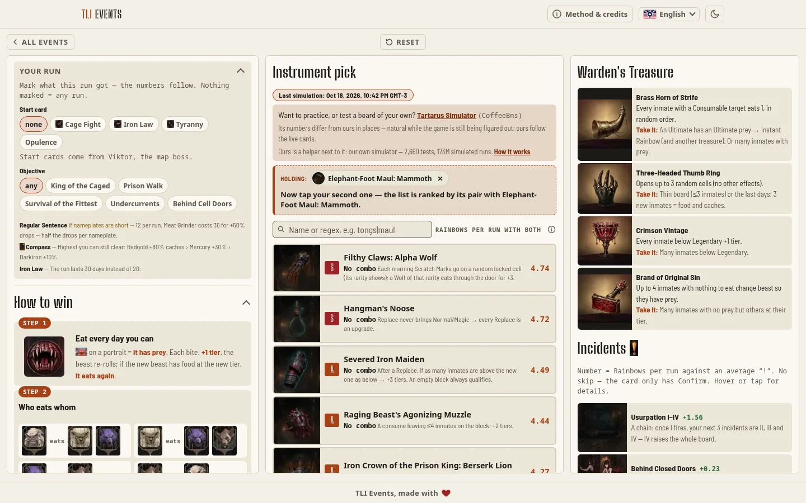
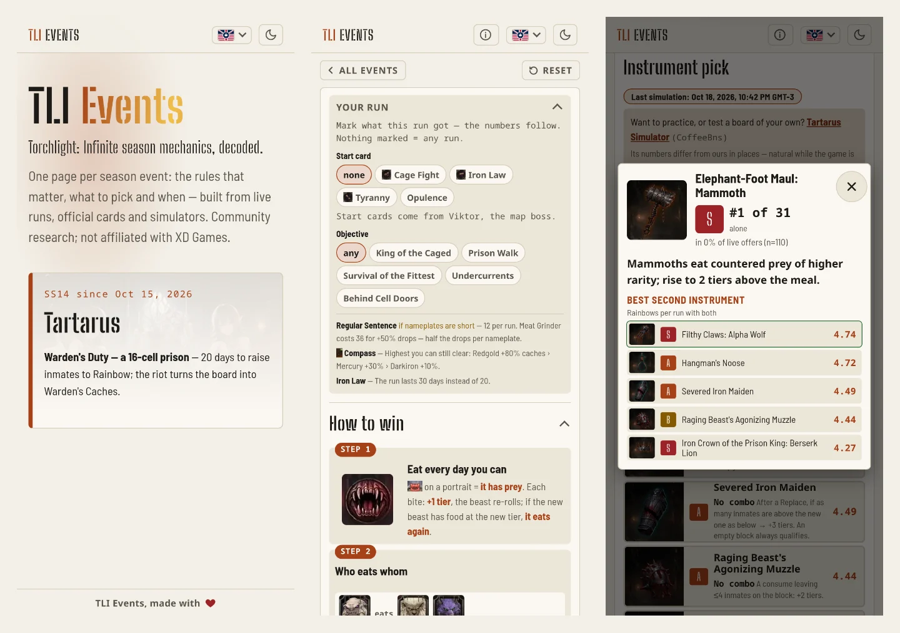
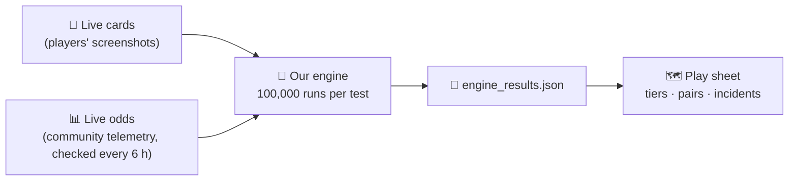

<p align="center">
  
</p>

<h1 align="center">TLI Events</h1>

<p align="center">
  <b>Torchlight: Infinite season mechanics, decoded — one play sheet per event, open next to the game.</b><br>
  <sub>Rules that matter · what to pick and when · numbers from our own simulator · every claim sourced</sub>
</p>

<p align="center">
  <a href="https://johnsonmauro.github.io/tli-events/"></a>
</p>

<p align="center">
  <a href="https://github.com/JohnsonMauro/tli-events/actions/workflows/deploy.yml"></a>
  <a href="CHANGELOG.md"></a>
  
  
  
</p>

<picture>
  <source media="(prefers-color-scheme: dark)" srcset="docs/readme/ss14-desktop-dark.webp">
  
</picture>

---

## In one minute

Every season XD Games ships a new event mechanic, and for the first weeks nobody knows the real rules: cards get reworded, odds are guessed, and the community's advice changes by the day.

**TLI Events turns that into one page per event** that you can keep open between runs. It says what to pick and why, with each number traceable to a live card, a measured odd or a simulation — and it changes as the season does.

| Event | Mechanic | Play sheet | Status |
|---|---|---|---|
| **SS14 Tartarus** (塔罗斯的困兽) | Warden's Duty — a 16-cell prison where inmates eat their way to Rainbow | [/ss14/](https://johnsonmauro.github.io/tli-events/ss14/) | live since Oct 15, 2026 |

## What the play sheet does

<picture>
  <source media="(prefers-color-scheme: dark)" srcset="docs/readme/phone-dark.webp">
  
</picture>

| | |
|---|---|
| 🎯 **Your run** | Mark the start card and the objective you got; the whole ranking follows them. |
| 🧰 **Instrument pick** | One ranked list, best first, with a tier (S → E) and *Rainbows per run* on every row. Tap the one you took: the list re-ranks by its pair, and each row says **Combo**, **Clash** or no combo — and why. Search by name or regex. |
| 🃏 **Cards** | Hover, focus or tap any instrument or incident for what it does, its rank and its best partner. On phones it opens as a dialog you can close. |
| 🗺️ **How to win** | The board patterns that turn inmates into Rainbow, step by step — patterns over prose. |
| 🎁 **Treasures & incidents** | What each one does, when to take it, and what each "!" is worth against an ordinary one. |

**Built for the minute between runs:**

- **12 languages** — English, Português (Brasil), Deutsch, Español, Français, Polski, Svenska, 한국어, 日本語, 简体中文, Русский, Tiếng Việt. Game terms stay in English so they match the client. The site offers your browser's language once and never redirects.
- **Phone first** — one screen on desktop, stacked on phones; no sideways scrolling at 390 px.
- **Works offline** after the first visit, and a notice tells you when a newer version is online.
- **Accessible** — WCAG 2.2 AA is the floor: axe runs on every page in the light and the dark theme, motion can be paused, and nothing depends on hover.

## Where the numbers come from



- **Our own simulator.** The tiers, pairs and incident values come from the [Tartarus engine](events/SS14_Tartarus/engine/) — written from scratch in Rust, following the live cards. The only outside numbers are the live odds players measured with the community board analyzer. The play sheet shows when the simulation last ran.
- **Every claim is labeled by source** in the research guide: `OFFICIAL` (patch notes, Steam), `LIVE` (seen in play, with sample size), `SIM` (simulator), `CALC` (derived math) or `PRE` (pre-launch theorycraft).
- **No invented numbers.** No source → the guide says "no data" and lists it under Gaps.
- **Corrections are logged.** When a bigger sample or a new card overturns a conclusion, the page changes and the event's CHANGELOG says when and why.

**Want to practice or test your own board?** Use the community's **[Tartarus Simulator](https://blahdot3h.github.io/tartarus-simulator/)** by **CoffeeBns** ([source](https://github.com/blahdot3h/tartarus-simulator), [YouTube](https://www.youtube.com/@CoffeeBns), [Twitch](https://twitch.tv/coffeebns)) — practice runs and a board reader. Our engine is a helper next to it; where the two disagree, the [engine's README](events/SS14_Tartarus/engine/README.md#rules-still-open) says why.

**Credits.** Each event page has a *Method & credits* dialog linking the YouTube and Bilibili channels whose work it builds on (twelve for SS14).

Spotted something wrong, or have live data? Open a **[Discussion](https://github.com/JohnsonMauro/tli-events/discussions)**.

---

## For contributors

<details>
<summary><b>Run it locally</b></summary>

You need Node ≥ 22.12 and pnpm 12. Google Chrome runs the browser tests and the image scripts; Python 3 (stdlib only) refreshes the data; [Rust](https://www.rust-lang.org/tools/install) (stable, edition 2024) only if you rerun the simulator.

```bash
pnpm install          # also turns on the pre-commit hook
pnpm dev              # http://localhost:4321, live reload (background; stop with `pnpm astro dev stop`)
pnpm build            # writes dist/
pnpm preview          # serves dist/ (background; stop with `pnpm astro preview stop`)
pnpm check            # type-check (astro check)
pnpm lint             # ESLint, CSS included
pnpm format           # Prettier
pnpm test:e2e         # build, then Playwright on every page
pnpm data             # run every events/*/scripts/update_data.py
pnpm icons            # favicon.ico, apple-touch and manifest PNGs from public/favicon.svg
pnpm readme-shots     # the screenshots above (after pnpm build)
```

The simulator: `cd events/SS14_Tartarus/engine && cargo build --release`, then see its [README](events/SS14_Tartarus/engine/README.md#run-it).

</details>

<details>
<summary><b>Quality gates</b></summary>

- **Pre-commit** (husky + lint-staged): Prettier, ESLint, `astro check`, and the full browser suite whenever the commit touches what the site shows. CI runs the same before every deploy.
- **Browser suite** (`e2e/`, Playwright + Chrome) on the built site: every page at 390 and 1440 px — no sideways scroll, no console errors, no words glued together by the HTML compressor; axe (WCAG 2.x A/AA) in both themes, with the play sheet's folds and cards open; every animation ends or can be paused; the play sheet's interactions on mouse, keyboard and touch; the service worker; the icons.
- **Lighthouse** 13.5.0, mobile, `pnpm preview`, 2026-10-19: performance 99–100, accessibility, best practices and SEO 100 on `/`, `/pt-br/`, `/ss14/` and `/ss14/ja/` (LCP 1.7–2.0 s, CLS 0).

</details>

<details>
<summary><b>How the repo is laid out</b></summary>

| Path | What lives there |
|---|---|
| `events/<Dir>/` | One self-contained folder per event: research guide, game CHANGELOG, data, art, scripts, simulator. `_template/` is the skeleton. |
| `src/sheets/<slug>/` | One play sheet per event: markup, texts (one file per language), client script, styles. |
| `src/pages/` | Routes: event list in every language, play sheets, 404, sitemap, web app manifest. |
| `src/components/`, `src/lib/` | Shared pieces (header, credits dialog, images) and site-wide modules (event registry, languages, update and language notices). |
| `src/styles/` | `theme.css` (palette for both themes, shadows) and `site.css`. |
| `public/` | `favicon.svg` (the source of every icon), the generated icons, `sw.js` (service worker). |
| `e2e/` | The browser suite. |
| `scripts/` | `icons.mjs`, `readme-shots.mjs`. |
| `docs/readme/` | The screenshots in this README (`pnpm readme-shots`). |
| `.github/workflows/deploy.yml` | Lint → build → deploy to GitHub Pages on every push; every 6 h, refresh the event data and commit it if it changed. |

The site is fully static and tuned for GitHub Pages: self-hosted fonts, CSS inlined into each page, responsive WebP images, and a service worker that makes up for Pages' 10-minute cache.

</details>

<details>
<summary><b>Adding a new event</b></summary>

1. `cp -r events/_template events/SS<nn>_<Name>` and fill in the guide's frontmatter — the event's card shows up on the list right away, unlinked.
2. Research with the method in [events/README.md](events/README.md): sources, access tricks, confidence labels.
3. Build the play sheet in `src/sheets/<slug>/` and add its route at `src/pages/<slug>/index.astro` — the card links to it once the route exists.

</details>

<details>
<summary><b>Releases</b></summary>

[Semantic Versioning](https://semver.org/spec/v2.0.0.html), judged by what a player notices: MAJOR when links break or content goes away, MINOR for something new (an event page, a language, a game patch), PATCH for corrections. Every visible change adds a line to [CHANGELOG.md](CHANGELOG.md) in the same commit; a release is a `chore(release): vX.Y.Z` commit plus the tag `vX.Y.Z`. What changed in the game itself is logged per event in `events/<Dir>/CHANGELOG.md`.

</details>

---

<sub>Community research. Not affiliated with XD Games. *Torchlight: Infinite* and its art belong to XD Games. Sources for each event are listed in its guide.</sub>
