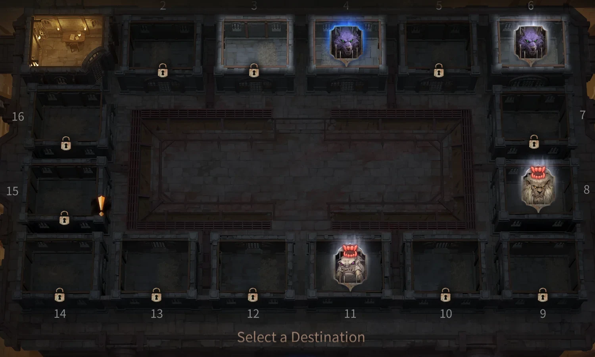
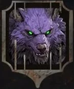
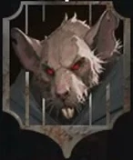
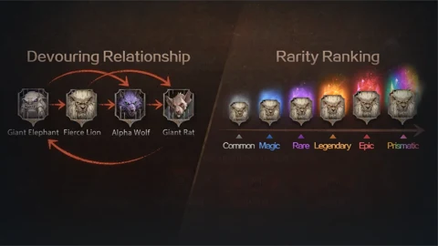
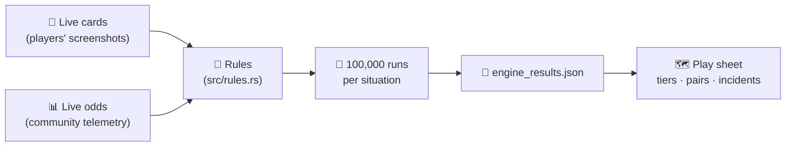

<p align="center">
  
</p>

<h1 align="center">Tartarus engine</h1>

<p align="center">
  <b>A simulator of the Warden's Duty, built to answer one question: which picks bring the most Rainbows?</b><br>
  <sub>Torchlight: Infinite · season SS14 · the numbers behind the <a href="https://johnsonmauro.github.io/tli-events/ss14/">TLI Events play sheet</a></sub>
</p>

<p align="center">
  
  
  
  
</p>

---

## In one minute



In Tartarus you are the **warden** of a prison of 16 cells. For 20 days you walk the ring, open doors and decide what each inmate does. Inmates **eat** the beasts they counter and rise a rarity tier each time; the ones that reach **Rainbow** (the top rarity) are vaulted — that is your score.

**Torture instruments** bend the rules (one at the start, one from the run's objective), and **incidents** — the "!" on the board — shake it up.

There are too many choices and too much luck to work out the best picks by hand. So this program **plays the season for us**: it follows the same rules as the live game and plays each situation **100,000 times**. What comes out is an average — *Rainbows per run* — that ranks every instrument, every pair of instruments and every incident.

<br clear="right">

### Who eats whom

<p>
  
  
  
  
  &nbsp;&nbsp;
  
</p>

| Eater | Eats (same rarity) |
|---|---|
| Mammoth | Berserk Lion, Alpha Wolf |
| Berserk Lion | Alpha Wolf, Colossal Rat |
| Alpha Wolf | Colossal Rat |
| Colossal Rat | Mammoth |

Each bite: **+1 tier**, then the eater turns into a random beast — if the new one has food, it eats again (a chain).

### One simulated day

| | Step | What the engine does |
|---|---|---|
|  | **Pick a door** | The game offers up to 3 cells ahead; the player picks one by what it could bring. |
|  | **Consume** | The inmate eats its prey (and maybe chains). |
|  | **Replace** | A weak inmate is swapped for a new random one. |
|  | **Incident** | Stepping on a "!" sets one off (Usurpation, Extra Portion, …). |
|  | **Rainbow!** | The inmate is vaulted and a Warden's Treasure is picked. |

The simulated player never peeks: closed doors stay closed until opened, and dice are re-rolled when it plans ahead.

### From the game to the page



### What it measures

| Number | Means | On the page |
|---|---|---|
| **Rainbows per run** | Average Rainbows in one 20-day run | Every row of the instrument list |
| **Tier S → E** | How close an instrument comes to the best one in the list: **S** ≥ 85% of the best one's gain, A 65%, B 45%, C 25%, D any gain, E none | The letter on each row |
| **Pairs** | Rainbows per run holding both instruments | The list once you hold your first one |
| **Incident worth** | Rainbows per run when the run's first "!" is that incident, minus an ordinary run | The order of the incident list |

### Where it stands among the tools

The community's go-to tool is the **[Tartarus Simulator](https://blahdot3h.github.io/tartarus-simulator/)** by CoffeeBns — practice runs and a board reader. This engine is a **helper next to it**, written from scratch (none of its code is used) to follow the live cards as soon as players print them. Where the two disagree, the reason is listed under [Rules still open](#rules-still-open) or in the [results](#results).

---

## For the technically curious

### Run it

You need [Rust](https://www.rust-lang.org/tools/install) (stable, edition 2024).

```bash
cargo build --release
./target/release/tartarus eval  --games 100000                  # full runs: Rainbows/run, spread, what the player did
./target/release/tartarus tools --games 100000                  # each instrument held from day 1 vs none (rewards off)
./target/release/tartarus eval  --tool rope,maiden              # a set held from day 1
./target/release/tartarus eval  --start cagefight --objective walk  # a start card and a fixed objective
./target/release/tartarus eval  --set muzzle_max=3 --set oppress_base=0.9   # try another reading of a rule
./target/release/tartarus export                                # everything the play sheet reads → ../data/engine_results.json (~35–65 min at 12 threads; 63 min on 2026-10-25)
cargo test --release                                            # rules tests
```

Options: `--seed WORD` (default `LAB`; **same seed = same result on any thread count**), `--threads N`, `--rewards on|off`, `--start cagefight|ironlaw|tyranny`, `--objective king|walk|consume|undercurrents|doors` (default random, as in the game), `--data PATH`.

Native and multi-threaded (`rayon`). It uses 40% of the logical cores by default so the machine stays usable; on all 32 threads of a 16-core Ryzen 9 9950X3D it plays ~140–180k full runs per second (2026-10-17).

<details>
<summary><b>What <code>export</code> writes</b></summary>

All from this engine, 100,000 runs per test (pairs per start card: 50,000):

- `base`, `tools`, `pairs` — no start card, rewards off: each instrument alone and every pair (31 instruments, 465 pairs).
- `run` — the full run with rewards on.
- `byStart.<card>` — its own base, instrument values and pairs (a start card changes the rules), with Warden's Treasures on (`treasures`; no instrument picks): Opulence only acts through them.
- `byObjective.<id>` — rewards on and that objective fixed (an objective only matters through its reward).
- `incidents` — what one "!" of each kind is worth: the full run with its first incident forced to that kind, minus the full run (same seeds). Usurpation I puts II into the draw.

The instrument pick inside the export uses the export's own solo values. The play sheet counts the tests from this file and shows the total next to the simulator box.

</details>

### Where the numbers come from

Rules come from the live cards transcribed in [`images/INDEX.md`](../images/INDEX.md), the [tlidb](https://tlidb.com/en/Tartarus_Season) glossary (Oppress, Scratch Marks, Tusk, Prey, Matching Inmate, …) and the team's own play. The only numbers taken from outside are the **live odds** players measured with the community analyzer (frozen since 2026-10-16), for lack of another sample.

<details>
<summary><b>The live odds, one by one</b></summary>

Read from `../data/tartarus_data.json` → `live` at start:

| Value | Source |
|---|---|
| Door rarity / beast odds | live `doorTiers`, `doorBeasts` (n=7,191) |
| Replace odds (incl. 0.3% Rainbow) | live `replaceTiers` (n=696) |
| Mornings with one door fewer | live `fewerDoorMornings` (16.9%) |
| Incident behind a door | live `eventDoorsDay1` (6.4%) |
| Lost Ring of Keys | live `keyRing` (62.8%; card 80%) |
| Instrument offer weights | live `toolOffers` counts + 1 |
| Doors come from the next **6** cells (`patrol_range`) | upstream `rates.json` → `mornings.stepsAhead`: offered doors spread evenly over 1–6 cells ahead (~4,100 each, n≈24,700; checked 2026-10-17) |
| Incident type | uniform — telemetry only splits Chain Reaction vs Execution (12 of 20), too few |
| The policy's instrument ranking | our own last export (`engine_results.json` → `tools`); all equal if it doesn't exist |

</details>

### Rules still open

A rule no source settles yet is a **parameter**, not code: when a new screenshot settles it, the default changes (`--set key=value` to try another reading).

<details>
<summary><b>The parameters and why each one is open</b></summary>

| Key | Default | Why open |
|---|---|---|
| `start_inmates`, `start_fewer`, `start_tiers` | 4, 0.05, 44.5/35/10.5/8/2 | print 45 (day 1, warden still in the office): 4 inmates out and "Open 10 cells" at 4/10, so they count as opened. Count, the 3-out runs and the rarities from the community telemetry (10,950 first boards, upstream tools/README, 2026-10-22); the raw boards aren't public. Before 2026-10-25 every run started sealed, which handed the Severed Iron Maiden a free +3 on every early Replace (0 above = 0 below) |
| `second_meal_from` | 0 (every rarity) | rules diagram + tlidb "Counter" draw no limit; players' boards show the jaws on Lions/Mammoths whose only meal is a second one below Legendary: 120 with, 3 without (community analyzer, 349 boards) and 149 with, 7 without (168 boards, tartarus-simulator issue #5, 2026-10-17); the game offered those Consumes (its reports 206, 208). Was 3 until 2026-10-18 |
| `muzzle_max` | 4 | live card (2026-10-17): "no more than 4 Inmates on the field, after Consuming"; the VOD card (print 34) said 3 |
| `maiden_any_time` | false | live card (print 88): "+3 additional Rarity Tiers to the Inmate after this Replacement" — after a Replace only. `true` = checked whenever the warden's inmate changes |
| `oppress_base`, `oppress_step` | 1.0, 0.05 | tlidb gives −5%/tier; base chance not printed — kept at 1.0, not watched by hand (owner's call, 2026-10-18) |
| `skewer_extra` | 2 | live card print 78 (+2); VOD and community sim +1 |
| `collar_first_bite` | false | Chinese live card (print 112): 囚犯連吃時, "when an Inmate eats in succession" — the first bite isn't one; the game's own language wins over the EN "When an Inmate Chain Consumes" (print 72) (owner's call, 2026-10-18) |
| `tusk_persists` | true | tlidb: Tusk goes "when there is no Inmate in this room"; content creator ALannister (2026-10-17): it stays through Replaces and clears only when the cell empties (eaten or Chromatic). `false` = gone after one Replace |
| `instigate_count` | 1 | in-game rules text (community sim uses 2) |
| `incident_respawn` | true | the team's play (2026-10-17, prints 92-94): a run starts with at least one incident, and a triggered incident is replaced by a new one elsewhere. The community simulator's telemetry (2026-10-17: 28% of first boards with none, new ones at random ~1 every 8 days) is not used: it is read from the game log by a third-party tool whose completeness nobody can check, while the rule above is what the owner saw in play (owner's call, 2026-10-18) |
| `can_skip_incidents` | false | live cards have only Confirm |
| `treasures` | false (true for `byStart`) | Warden's Treasures without the instrument picks: the export's start-card numbers include them, since **Opulence** acts only through them. Opulence (start card): each Treasure is 3 picks in a row — the card's text is printed by us (print 142, 2026-10-19: "2 additional choices when obtaining Warden's Treasure"); reading it as picks rather than a wider offer rests on a player's log quoted by the community simulator (7 Rainbows, 21 picks), used on the owner's call (2026-10-18) |
| `rainbow_cap` | 10 | confirmed in play (2026-10-17); one run in ~70 reaches it |
| `execution_same_tier` | false | card: lower-tier prey |

Settled by prints and built in (no parameter): **Usurpation** I–IV are +1 tier to one inmate, +2 to one, +2 to two, +2 to all (prints 102–105); each card swaps the next stage into the incident draw, so the next stage comes when a "!" draws it — not as the next incident triggered (owner, 2026-10-19: I, then another incident; until that day the engine forced II–IV as the next three, from the owner's run of 2026-10-18). A "!" still holding a stage that already fired draws again (not printed). **Transfer of Convicts** (new incident) copies the warden's inmate — same beast and rarity — into a random locked cell, which opens, as the Searing Branding Iron's copy does (prints 132–133, 2026-10-18); it joins the uniform incident draw.

Open, no data: players report Usurpation II or III as a run's first one — not seen by us, and nothing says a stage carries over between runs; the engine starts every run at I. Not modelled yet: Tartarus Rumors, the riot itself, the contract challenge, events in open cells appearing on their own. Incidents are drawn uniformly (no live rate per incident). Morning effects run in a fixed order (prey, nests, Iron Box, Tongs, Claws, Coin, Ravenous Chains); the game's order isn't documented.

</details>

### The simulated player (`src/policy.rs`)

Simple and explicit: a board value (`w_tier` per rarity, `w_rainbow`, `w_event`, `w_objective`, `w_chain`, `w_tusk`) scores every bite, Replace and Hunt analytically; patrols, treasures and incident choices are played out on copies with the hidden doors and the dice re-rolled (`samples` copies per option), so it never sees what a player can't. The weights are a first guess — tune them with `eval`. `w_tusk` (12): a Tusk cell kept is worth that much, and a Mammoth half of it while holding Iron Tongs, so the player stops eating them (ALannister's play); it lifts Tongs 2.87 → 3.05 and changes nothing without Tongs.

### Code map

| File | What lives there |
|---|---|
| `src/model.rs` | The board, beasts, rarities, instruments, incidents |
| `src/rules.rs` | Every rule of the game, with its tests |
| `src/policy.rs` | The simulated player |
| `src/run.rs` | One run, and many in parallel |
| `src/params.rs` | Rule values and open rules |
| `src/main.rs` | The command line and `export` |

## Results

<sub>2026-10-25 (UTC) · 100,000 runs per test (2,660 tests, 63 min at 12 threads) · seed `LAB` · `export`</sub>

- No instrument **1.216** Rainbows/run (rewards off); full run with rewards **3.46** (median 3, zero in 2.9%); live runs (n=114, before most of these rules were known) mean 2.04, median 2.
- Best solos: **Iron Tongs 3.65**, Elephant-Foot Maul 3.33, Iron Crown 3.31, Filthy Claws 2.94, Executioner's Blacklist 2.83. Best pair: Squirming Iron Box + Skewered Rat Heads 8.23, then Hangman's Noose + Iron Tongs 5.71. (Maul and Crown are rare in live offers.)
- Start cards (`byStart`, rewards off, Warden's Treasures on): **Cage Fight** base 5.48, top Raging Beast's Agonizing Muzzle 8.07, Iron Crown of the Prison King 8.00, Filthy Claws 7.49; **Iron Law** base 3.08, top Iron Tongs of Lust 8.68, Elephant-Foot Maul 7.66, Iron Crown of the Prison King 6.78; **Tyranny** base 4.85, top Iron Tongs of Lust 7.70, Elephant-Foot Maul 7.64, Iron Crown of the Prison King 7.12; **Opulence** base 3.13, top Iron Tongs of Lust 8.65, Elephant-Foot Maul 8.62, Kin's Coin of Fate 7.88. Against no start card with Treasures (1.58, `eval --rewards off --set treasures=true`): Iron Law +1.50, Opulence +1.55, Tyranny +3.27, Cage Fight +3.90 — Iron Law and Opulence are the weakest start cards here.
- Objectives (`byObjective`, rewards on): base 3.25 (Survival of the Fittest) to 3.66 (Prison Walk); Maul, Tongs, Crown and Claws lead in every one — an objective moves the values, barely the order.
- Incidents (one "!" against an ordinary one): Behind Closed Doors **+0.36**, Extra Portion +0.30, High-Risk Convict +0.17, Ravenous Appetite +0.10, Taste of Freedom +0.09, Shared Fortune +0.03, Usurpation −0.01; the rest cost a little — Chain Reaction −0.06, Archenemy −0.11, Sewer Ratway −0.12, Transfer of Convicts −0.13, Execution Efficiency −0.15, Crow Whispers −0.25, "Treasure" Hunt −0.27 (they show or move, they don't raise).
- What moved on 2026-10-25: **a run starts with 4 inmates out** (3 in 5%), as print 45 shows on day 1, instead of a sealed board. No instrument 1.133 → 1.216, full run 2.99 → 3.46. Instruments that pay on inmates already on the block rose most: Iron Tongs 2.82 → 3.65 (#4 → #1, a Tusk from the first morning), Executioner's Blacklist 2.13 → 2.83 (#10 → #5, ≤5 locked cells comes sooner), Iron Crown and Maul +0.4 to +0.5. **Severed Iron Maiden fell 2.55 → 1.78 (#5 → #15)**: an empty block met its balance (0 above = 0 below) on every early Replace, a free +3 the live game doesn't give; Noose + Maiden 9.53 → 5.24.
- What moved on 2026-10-19 (night): **Usurpation** is no longer a forced chain. Each stage swaps the next into the draw (1 in 14), so II–IV come only if a "!" draws them (owner: Usurpation I, then another incident). One Usurpation "!" fell from +1.56 to +0.00 (I alone is +1 tier to one inmate; II comes only if a later "!" draws it), and runs lost what the chain gave: no instrument 1.436 → 1.133, full run 3.25 → 2.99, every solo 0.22–0.27 (top five in the same order); Tyranny, whose Instigates set off more incidents, 5.80 → 4.58. The other incidents read about +0.1 higher, as the run they are measured against is lower.
- What moved on 2026-10-19: **Transfer of Convicts** joined the uniform incident draw (1 in 13, worth −0.26 — close to Archenemy's −0.23, the other incident that opens a cell with a set inmate), so the base fell 1.486 → 1.436, the full run 3.30 → 3.25 and every solo by 0.02–0.07; the order on top is unchanged.
- What moved later on 2026-10-18: the Barbed Collar's +1 only on bites in succession (Chinese card 連吃, print 112) dropped it 2.82 → 1.77 (#6 → #19) and its pairs up to −1.77; the full run 3.51 → 3.30 (it shows up in 13% of offers). Start cards now count Treasures; Opulence added. Every other solo value unchanged (same seed).
- What moved on 2026-10-18: second meals at every rarity (players' boards) lifted Maul 2.49 → 3.23 (#11 → #1), Muzzle 1.99 → 2.41, Collar 2.59 → 2.82, Blood-Stained Trap 2.02 → 2.34; Usurpation as a chain with II = +2 to one inmate.
- Card readings this engine follows where the community sim differs: Skewer +2, Oppress, Instigate 1, the incident refill, Shared Fortune, Archenemy, Extra Portion, Usurpation's stages through the draw, second meals at every rarity. Earlier rule changes moved Muzzle (≤4 inmates: Cage Fight 5.13 → 5.71), Maiden (after a Replace only: 4.19 → 2.79) and Tongs (Tusk stays: 1.88 → 3.05).

<sub>Game art © XD Games, used to explain the game. The engine is the TLI Events team's own work.</sub>
